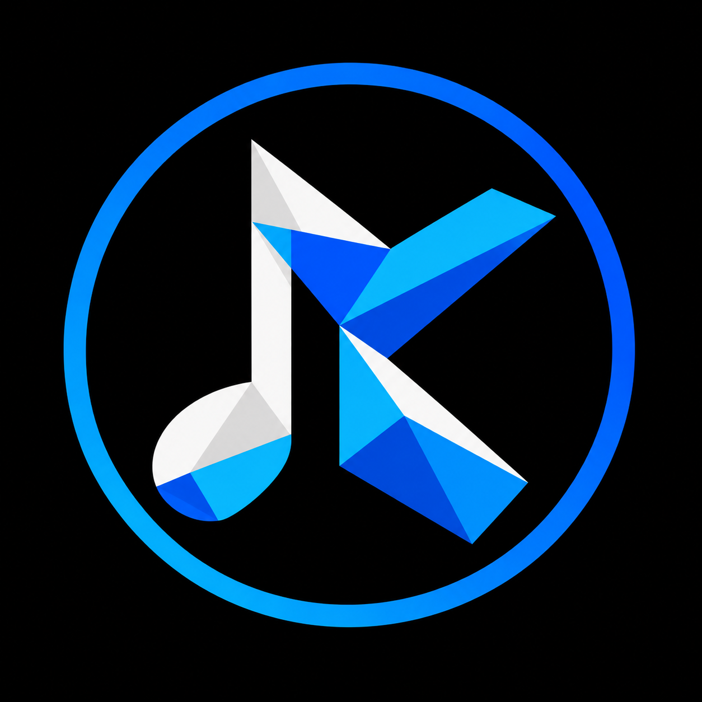
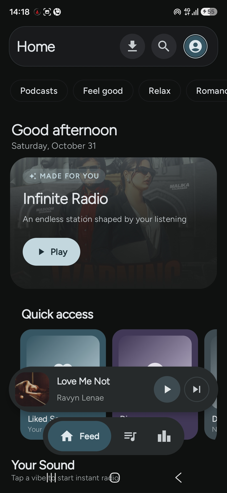
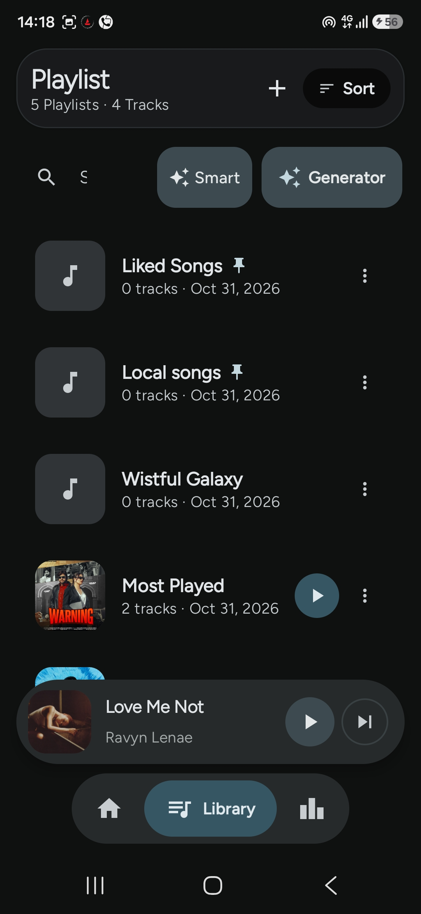
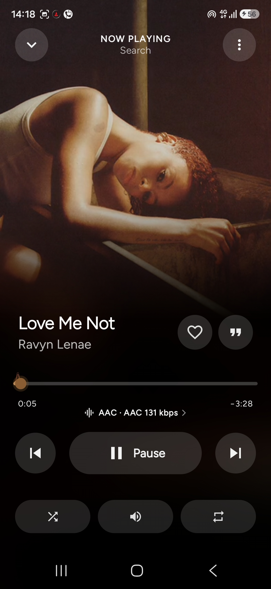
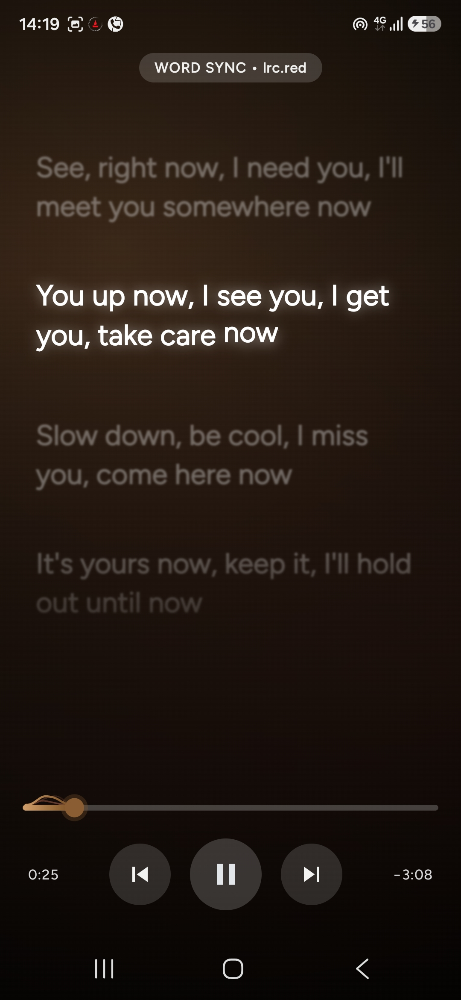
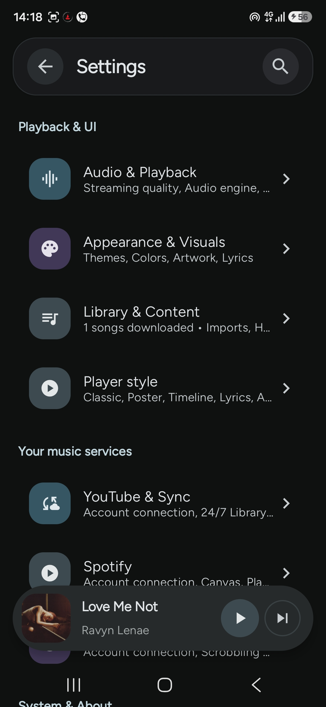
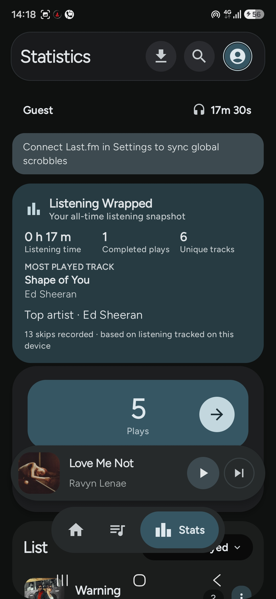
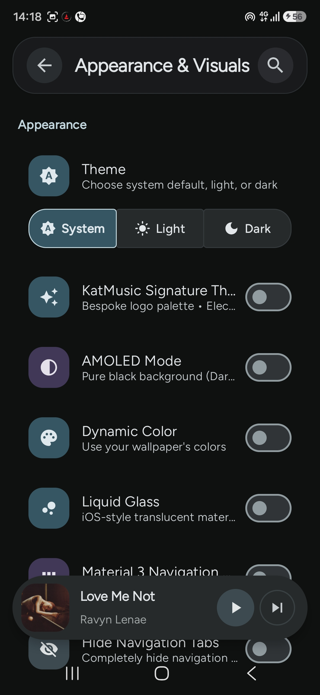

<div align="center">



# KatMusic

### Your music, with room to make it yours.

A native Android music player built around YouTube Music, with synced lyrics, offline downloads, a powerful audio engine and a highly customisable player.

<p>
  <a href="https://github.com/ItzFallenMe/KatMusic/releases/tag/2.1.0"><strong>Download v2.1.0</strong></a>
  &nbsp;·&nbsp;
  <a href="https://katmusic.pages.dev">Project website</a>
  &nbsp;·&nbsp;
  <a href="CHANGELOG.md">Changelog</a>
</p>


[](https://github.com/ItzFallenMe/KatMusic/releases)
[](https://github.com/ItzFallenMe/KatMusic/actions/workflows/android.yml)
[](https://github.com/ItzFallenMe/KatMusic/releases)
[](LICENSE)
[](https://github.com/ItzFallenMe/KatMusic/stargazers)

**Kotlin · Jetpack Compose · Material 3 · C++ · Oboe**

</div>

---

## About

KatMusic brings streaming, your personal library and advanced playback controls into one Android app. It combines a Compose interface with a native audio engine, so everyday listening and deeper audio controls live in the same place.

Some integrations require you to sign in or provide your own service credentials. Optional AI features use the endpoint and API key you configure.

## Contents

- [Features](#features)
- [Player styles](#player-styles)
- [Screenshots](#screenshots)
- [Download and install](#download-and-install)
- [Build from source](#build-from-source)
- [Project structure](#project-structure)
- [Privacy and security](#privacy-and-security)
- [Contributing](#contributing)
- [Credits](#credits)
- [License](#license)
- [Disclaimer](#disclaimer)

## Features

### Music and playback

- Browse and play songs, albums, artists, playlists, mixes and podcasts from the YouTube Music catalogue.
- Background playback with media notifications, lock-screen controls, queue management, shuffle, repeat and autoplay.
- Browse and control your library through Android Auto.
- Playback speed, sleep timer, loudness processing and audio-quality options.
- Listen Together lets people on the same local Wi-Fi follow a host's playback using a room code.

### Audio engine

- Native audio processing built around C++ and [Oboe](https://github.com/google/oboe).
- Parametric equaliser, graphic EQ, presets and AutoEQ headphone profiles.
- Automix with crossfade planning, BPM/phase analysis and WSOLA time stretching.
- USB exclusive output and direct-output paths on supported devices and audio hardware.

> Output modes, supported codecs and bit-perfect behaviour depend on the Android device, DAC and audio route. The app cannot override hardware or operating-system limitations.

### Lyrics

- Line-synced and word/syllable-synced karaoke lyrics.
- Multiple lyric sources with provider selection and fallback handling.
- Translation, romanisation, text-size controls and timing offset.
- Shareable lyric cards.

### Library and discovery

- Home feed, search suggestions, Explore, new releases, genres and listening statistics.
- Liked songs, playlists, listening history, downloads and local music.
- Genre discovery and Smart Mix recommendations.
- Optional AI music picks using an OpenAI-compatible endpoint that you configure.
- Podcast and video-podcast support.

### Downloads

- A visible download queue with progress, cancel and retry.
- Wi-Fi-only downloads that pause on mobile data and resume when Wi-Fi returns.
- Saved artwork, lyrics and audio metadata where the source and format support them.
- Downloads are organised under <code>Music/KatMusic</code>.

### Integrations

- Spotify Canvas artwork.
- Last.fm scrobbling and listening activity.
- Discord Rich Presence.
- YouTube Music account support for personalised features and library access.

### Personalisation

- Material 3 interface with light, dark and pure-black themes.
- Wallpaper- and artwork-derived colour palettes.
- Floating navigation dock, expressive transitions and a home-screen widget.
- Player layout selection, lyric appearance controls and additional playback settings.

## Player styles

Choose the expanded player layout in **Settings → Playback & UI → Player Style**.

| Style | What it does |
| --- | --- |
| **Classic** | KatMusic's full player with its tabs, queue and advanced controls. |
| **Poster** | Large circular artwork with expressive track text and synced lyric context. |
| **Timeline** | A progress-led layout with a colour split and oversized timestamps. |
| **Lyrics** | An expressive lyrics-focused view with timed syllable highlighting. |
| **Artwork** | Large album artwork with focused playback controls. |
| **Canvas** | An immersive player background using available Canvas artwork. |

The Poster, Timeline and expressive Lyrics concepts are adapted from [Mochy Music](https://github.com/InlitX/Mochy-Music). The original source files and their GPL-3.0 licence are preserved in [third_party/Mochy-Music](third_party/Mochy-Music/README.md).


## Screenshots
<div align="center">
  

  
  
  
  <br/>
  <br/>
  
  
  
</div>

## Download and install

**Latest stable release: [KatMusic 2.1.0](https://github.com/ItzFallenMe/KatMusic/releases/tag/2.1.0)**

Choose the package that matches your device:

| Package | Android version | Recommended for |
| --- | --- | --- |
| [Universal APK](https://github.com/ItzFallenMe/KatMusic/releases/download/2.1.0/KatMusic-v2.1.0-universal.apk) | Android 10+ | Most devices. Recommended for normal installation. |
| [ARM64 APK](https://github.com/ItzFallenMe/KatMusic/releases/download/2.1.0/KatMusic-v2.1.0-arm64-v8a.apk) | Android 10+ | 64-bit ARM phones and tablets. |
| [Legacy APK](https://github.com/ItzFallenMe/KatMusic/releases/download/2.1.0/KatMusic-v2.1.0-android7.apk) | Android 7–9 | Older supported devices. Some visual effects and media controls use legacy alternatives. |
| [Uncompressed universal APK](https://github.com/ItzFallenMe/KatMusic/releases/download/2.1.0/KatMusic-v2.1.0-universal-uncompressed.apk) | Android 10+ | Larger, uncompressed package for troubleshooting and testing. |

1. Download the APK that matches your device.
2. Open the downloaded file and approve installation when Android asks.
3. Launch KatMusic and configure account access or optional integrations from Settings.

You can also download the [SHA-256 checksums](https://github.com/ItzFallenMe/KatMusic/releases/download/2.1.0/SHA256SUMS.txt) to verify a package, or browse [all releases](https://github.com/ItzFallenMe/KatMusic/releases).

## Build from source

### Requirements

- JDK 17
- Android SDK with **platform 37**
- Android NDK
- CMake **3.22.1** (used by the native audio engine)

### Clone and build

```bash
git clone https://github.com/ItzFallenMe/KatMusic.git
cd KatMusic

# Build a debug APK
./gradlew :app:assembleDebug

# Run local unit tests
./gradlew :app:testDebugUnitTest

# Build a signed release APK
./gradlew :app:assembleRelease
```

The debug APK is generated at:

<code>app/build/outputs/apk/debug/app-debug.apk</code>

### Release signing

Release builds require your own signing key. KatMusic deliberately refuses to create a release APK with a temporary debug key, because an incorrectly signed update would not install over the existing app.

For a local build, copy [.env.example](.env.example) to <code>.env</code> and set the signing values:

```dotenv
RELEASE_STORE_FILE=path/to/release.keystore
RELEASE_STORE_PASSWORD=your_keystore_password
RELEASE_KEY_ALIAS=your_key_alias
RELEASE_KEY_PASSWORD=your_key_password
```

A base64-encoded keystore can also be supplied with <code>SIGNING_KEY</code> and the matching password/alias environment variables. Keep <code>.env</code>, keystore files, passwords and API keys private. **Never commit signing credentials or personal tokens.**

For the CI build and contribution workflow, see [CONTRIBUTING.md](CONTRIBUTING.md).

## Project structure

| Path | Purpose |
| --- | --- |
| <code>app/src/main/java/.../data/</code> | Catalogue, accounts, lyrics, downloads, library and settings data. |
| <code>app/src/main/java/.../playback/</code> | Player state, playback coordination and audio features. |
| <code>app/src/main/java/.../ui/</code> | Compose screens, components, player and theming. |
| <code>app/src/main/cpp/</code> | Native audio engine and DSP implementation. |
| <code>audio/</code> | Native audio support modules. |
| <code>website/</code> | KatMusic project website. |
| <code>third_party/</code> | Third-party source and licence notices. |
| <code>tools/</code> | Build and development utilities. |

### Main technologies

- **Kotlin** and **Jetpack Compose** for the Android application.
- **Material 3** for the interface and theming.
- **Media3 / ExoPlayer** for media playback and media-session integration.
- **Hilt**, **StateFlow**, **DataStore** and **Room** for app state and persistence.
- **C++** and **Oboe** for native audio processing and output.

## Privacy and security

- KatMusic does not bundle an analytics or advertising-tracking SDK.
- Network requests go to the catalogue, lyric and integration services needed for the features you use.
- Account sessions and locally configured credentials are stored on-device; do not include them in bug reports or commits.
- Optional integrations such as Last.fm, Discord and AI recommendations are controlled by your settings. AI requests are sent to the endpoint you configure.

For security issues, please follow [SECURITY.md](SECURITY.md) rather than posting sensitive details in a public issue.

## Contributing

Contributions, bug reports and thoughtful feature requests are welcome.

- Read the [contribution guide](CONTRIBUTING.md) before opening a pull request.
- For bugs, include reproduction steps, Android version, device details and relevant logs.
- For larger features, open an issue first so the approach can be discussed.
- Keep credentials, tokens, keystores and personal data out of commits.

Please also read the [Code of Conduct](CODE_OF_CONDUCT.md).

## Credits

KatMusic builds on the work of many open-source projects and services:

- **[Mochy Music](https://github.com/InlitX/Mochy-Music)** by [InlitX](https://github.com/InlitX) — source and design inspiration for the Poster, Timeline and expressive Lyrics player styles. Original files and GPL-3.0 licence: [third_party/Mochy-Music](third_party/Mochy-Music/README.md).
- **[SimpMusic](https://github.com/maxrave-dev/SimpMusic)** — lyrics-provider and integration reference.
- **[Lastwave](https://github.com/Clash-Projects/LastWave-native)** — design and architectural inspiration.
- **[RiMusic](https://github.com/fast4x/RiMusic)** — InnerTube and YouTube Music integration reference.
- **[Monochrome Music](https://github.com/monochrome-music/monochrome)** — FLAC and lossless-streaming reference.
- **[NewPipe Extractor](https://github.com/TeamNewPipe/NewPipeExtractor)** — stream extraction.
- **[Coil](https://github.com/coil-kt/coil)** — image loading.
- **[Oboe](https://github.com/google/oboe)** — low-latency native audio.
- **AndroidX, Jetpack Compose, Material 3 and Media3** — application UI and media foundations.

Lyrics may be supplied by LRCLIB, Apple Music, YouTube Music and other providers available in the app. Service names and trademarks belong to their respective owners.

## License

KatMusic is licensed under the **GNU General Public License v3.0**. See [LICENSE](LICENSE).

Third-party code remains subject to its own notices and licence terms. In particular, Mochy Music's preserved source is covered by the GPL-3.0 licence included at [third_party/Mochy-Music/LICENSE](third_party/Mochy-Music/LICENSE).

## Disclaimer

KatMusic is an independent, third-party project. It is not affiliated with, endorsed by or officially connected to Google or YouTube. YouTube and YouTube Music are trademarks of Google LLC.

---

<div align="center">

**Made by [Arct Developments](https://github.com/ItzFallenMe)**

[Website](https://katmusic.pages.dev) · [Releases](https://github.com/ItzFallenMe/KatMusic/releases) · [Issues](https://github.com/ItzFallenMe/KatMusic/issues)

</div>
